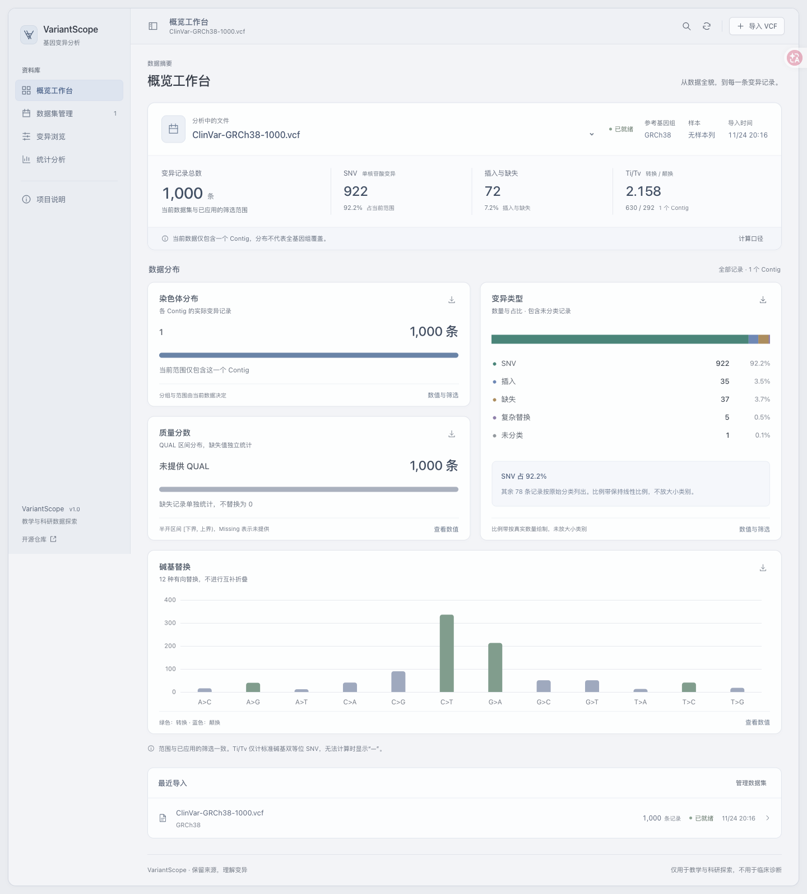
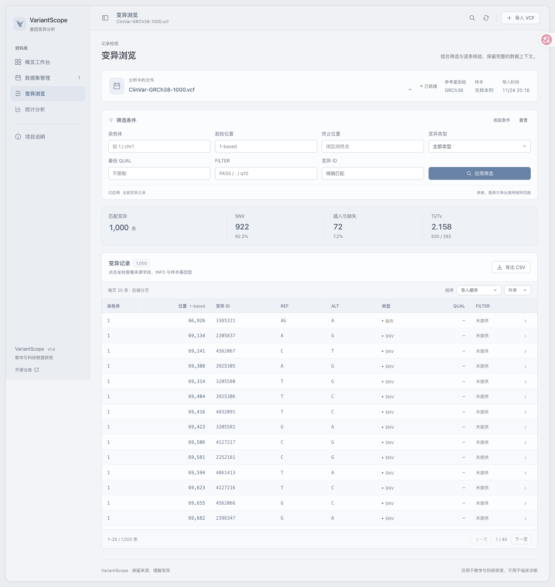
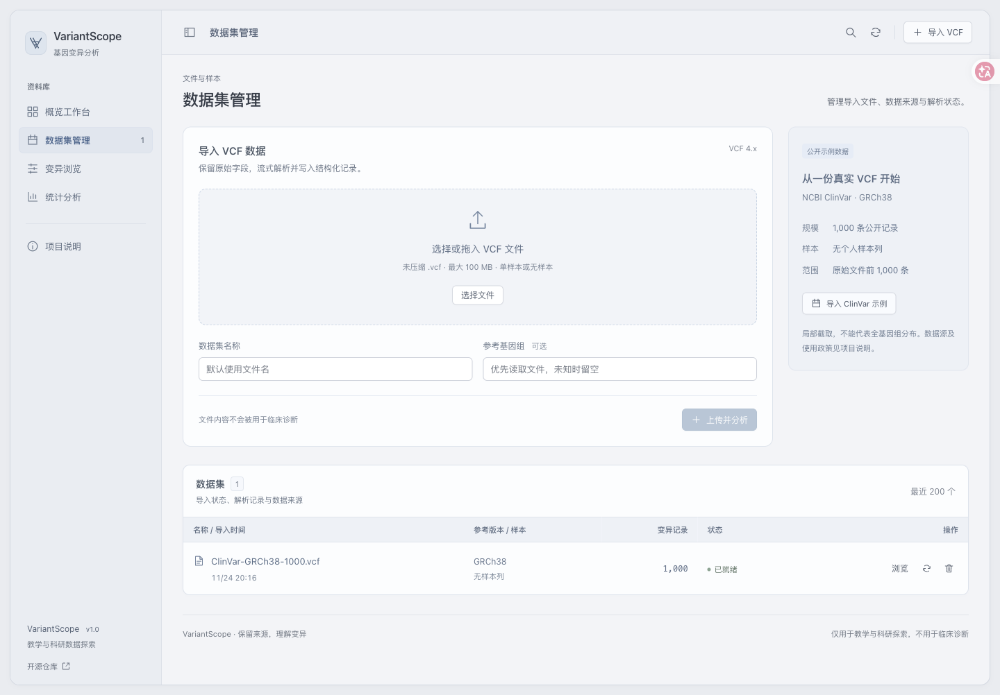
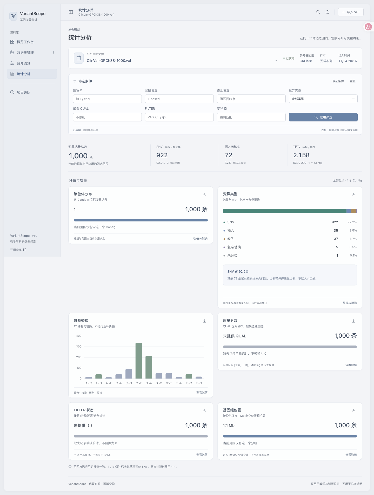
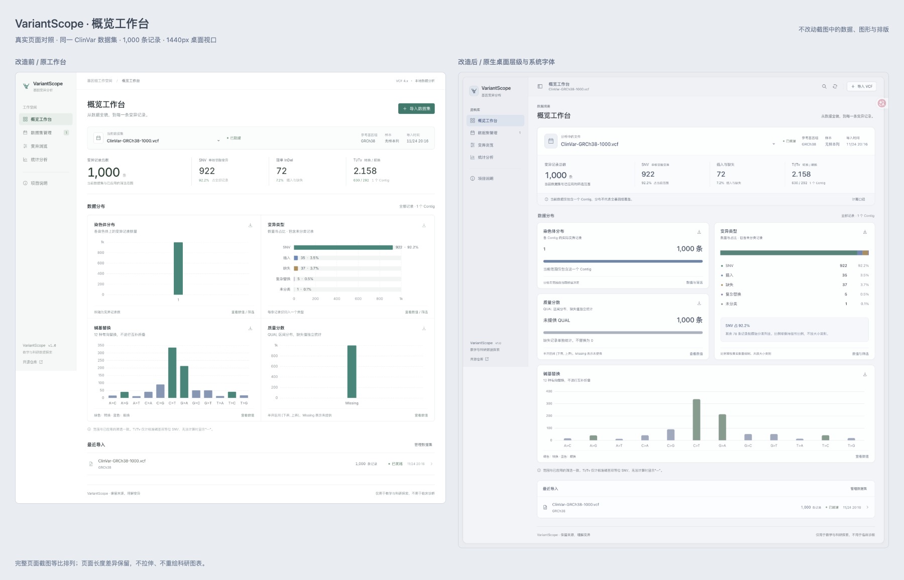

# VariantScope

基因变异数据分析与可视化平台 · V1.0

面向软件工程专业《生物信息学》课程拓展考核的开源项目。使用 Java 17、Spring Boot 3、MySQL 8、Vue 3、TypeScript、Vite、ECharts，完成真实 VCF 的导入、存储、分页检索、统计和交互可视化。由空目录独立实现，未复制 MedEvidence 或第三方业务项目。

仅用于教学和科研数据探索，不提供临床诊断或系统推断的致病性结论。

## 功能

- 标准 VCF 4.x 文本，8 列无样本或 10 列单样本；完整保留元数据、原始记录、INFO、FORMAT 和样本字段。
- 流式读取，每 500 条 JDBC 批量写入；100 MB、100 万记录、64 KiB 字符行上限、1 MiB 元数据字符上限；单进程同时一个导入。
- SHA-256 重复检测，READY / IMPORTING / FAILED 状态；失败后清理已写入批次并保留错误行号。
- 简单双等位 SNV、锚定插入/缺失分类；多等位和结构 ALT 明确标记 UNSUPPORTED，复杂替换为 COMPLEX；不偷偷拆分或左对齐。
- 后端组合筛选、稳定排序和分页；详情包含原始坐标、REF/ALT、QUAL、FILTER、INFO 与 GT。
- 数据集查看、删除及从已存储记录重新计算统计；筛选结果流式 CSV，图表 PNG 导出。
- 概览、数据集管理、变异浏览、统计分析、项目说明五个页面；空/加载/错误状态、上传进度、删除确认和响应式布局。
- 真实 ClinVar GRCh38 公开示例可一键导入，不依赖 API 密钥；另有明确标记的合成边界样例。

## 真实运行截图









前端已按桌面专业应用的层级重设计，采用系统字体、组合式文件摘要与数据自适应图表。设计决策、五页真实前后对照、桌面/手机验证和限制见 [原生层级重设计验收](docs/NATIVE-REDESIGN.md)。前一轮验收记录仍保留作历史参考。



## 快速运行

需要 Java 17、Maven 3.9+、Node 22+、npm 和正在运行的 MySQL 8。

```bash
git clone https://github.com/whisper-uoo/VariantScope.git
cd VariantScope
mysql -uroot -p < scripts/init-db.sql
```

初始化 SQL 只创建专用数据库和本地账户。按实际环境修改密码，不会操作其他项目表。复制 `.env.example` 为 `.env` 并填写连接配置；Spring Boot 不自动读取 dotenv，使用 shell 显式导出：

```bash
set -a
. ./.env
set +a
mvn -f backend/pom.xml spring-boot:run
```

另一个终端：

```bash
cd frontend
npm ci
npm run dev
```

打开 http://127.0.0.1:5173 ，进入“数据集管理”，点击“导入 ClinVar 公开示例”。后端默认 8080，Vite 把 `/api` 代理到后端；首次启动由 Flyway 自动执行 `backend/src/main/resources/db/migration/` 中的 V1、V2 迁移。已有数据库升级不删除数据，勿手动修改已执行的迁移文件。

数据库使用非默认端口时，例如：

```bash
export DB_URL='jdbc:mysql://127.0.0.1:3307/variantscope?rewriteBatchedStatements=true'
export DB_USER=variantscope
export DB_PASSWORD=variantscope
```

建议保留 `rewriteBatchedStatements=true` 开启 MySQL 驱动批量重写。

## Docker Compose（可选）

```bash
docker compose up --build
```

MySQL 数据保存在命名卷中，网页 http://127.0.0.1:5173 。后端 Dockerfile 构建时运行测试，前端 Nginx 代理 `/api` 并将读取超时设为 300 秒。本次机器未安装 Docker，Compose 配置提供但未声称已实际验证；本次验收使用原生 Java、MySQL 8 和 Vite。

生产前端：`npm run build`，生成 `frontend/dist`；后端：`mvn -f backend/pom.xml package` 后运行 `java -Xmx512m -jar backend/target/variantscope-1.0.0.jar`。静态部署需配置同源 `/api` 反向代理，不能直接双击 index.html。

## 统计口径

| 指标 | 计算方式 |
|---|---|
| 总数 | 当前筛选下每行 VCF 计一条记录，包含未分类记录 |
| SNV | REF、ALT 各为一个碱基；N 替换保留类型，但不计入 Ti/Tv |
| 简单 InDel | 单碱基 REF 且 ALT 以 REF 开头为插入；单碱基 ALT 且 REF 以 ALT 开头为缺失 |
| 类型占比 | 所有记录为分母，复杂/不支持类别独立呈现 |
| 碱基替换 | A/C/G/T 双等位 SNV 的 12 种有向替换，不进行互补折叠 |
| Ti/Tv | A↔G、C↔T 为转换，其余标准碱基 SNV 为颠换；Tv=0 时为 null/“—” |
| QUAL | [0,20)、[20,50)、[50,100)、[100,+∞)；缺失单列 Missing |
| FILTER | 原始字符串分组；PASS、`.`、多标签组合保持不同类别 |
| 染色体 | 按原始 CHROM 精确值分组，chr1 与 1 不自动合并 |
| 位置分布 | 1-based 坐标，以 floor((POS−1)/1,000,000) 分箱；非空箱最多 10,000 个，超出时截取按染色体及位置排序的前部 |

所有图表和摘要都使用当前数据集与已应用的筛选条件。点击染色体和类型图会进入对应的变异筛选。CSV 采用固定导入顺序，导出范围与筛选一致。

## 工程结构

```text
backend/                 Spring Boot API
  .../ApiController      HTTP 边界、分页与 CSV 响应
  .../DatasetService     导入编排、状态与失败清理
  .../VcfParser          纯解析与类型分类
  .../VariantRepository 参数化 SQL、组合查询、批量写入
  .../StatisticsService SQL 聚合与 Ti/Tv
  .../db/migration/      Flyway V1/V2
frontend/src/            Vue + TypeScript + ECharts 工作台
data/                    ClinVar 子集、来源许可、合成边界样例
scripts/                 数据库初始化、HTTP 验收、性能复现
docs/                    API、实测记录、真实截图
```

`datasets` 保存 SHA、名称、样本、参考版本、元数据、状态和记录计数；`variants` 使用外键级联删除，按 `(dataset_id,chrom,pos)`、`(dataset_id,type)`、`(dataset_id,qual)` 建索引。未建立 INFO JSON 搜索、全文索引或医学注释模型。所有用户筛选值使用占位符，排序列/方向由白名单选择。上传使用系统生成临时文件名，不把上传文件名作为路径，不执行文件内容。

## 测试与复现

```bash
mvn -f backend/pom.xml verify
cd frontend && npm ci && npm run test && npm run build
# 在已启动后端、真实 MySQL 环境中，从仓库根目录运行：
python3 scripts/smoke.py
python3 scripts/benchmark.py --records 100000 --pid <后端Java进程PID> --output benchmark.json
```

后端 JUnit + H2 MySQL 模式验证核心逻辑，真实 MySQL 8 的 Flyway 和 HTTP 验收另行执行。性能脚本生成明确标记的合成数据，记录导入、查询、全量统计时间和每 100ms 采样的 Java RSS，最后删除自身创建的数据集。不依赖个人凭证或收费服务。详细数值与验证边界见 [验收记录](docs/VALIDATION.md)、[API](docs/API.md)、[数据来源](data/SOURCES.md)。

## 已知限制

- V1 面向本地单用户课程演示，没有登录、权限隔离、任务队列或多实例协调；不宜直接暴露到公网。
- 不支持 gzip/BCF、多样本、注释补全、关联分析、变异效应预测、临床解释、参考序列校验、左对齐及等价变异归一化。
- INFO 解析为原始键/值或 flag 展示，不对所有自定义元数据的 Number/Type 进行完整语义验证；非 GT FORMAT 原样保留并标注限制。
- 断点续传及进程崩溃后的自动恢复未实现；遗留 IMPORTING 状态需管理员确认任务停止后处理。正常失败可删除后重新导入。
- 同文件重复使用 SHA-256 拒绝；相同变异在不同内容文件中不会全局去重。FAILED 同文件也需先删除条目再上传。
- 同步导入期间显示上传百分比和解析等待状态，不将网络上传百分比冒充解析百分比。
- 数据集列表最多展示最近 200 个，位置图最多 10,000 个非空箱；没有虚拟表格或任意大规模染色体浏览器。
- MySQL 深分页与临时聚合开销随数据量增长；性能报告只代表单机顺序基线，未做多用户并发承诺。
- 未与 bcftools/HTSJDK 交叉验证；不声称实现完整 VCF 规范校验器。Docker 路径未在本机运行。

## 开源许可

软件采用 [MIT](LICENSE)。示例数据按 [ClinVar 数据使用政策](data/SOURCES.md) 单独归属并注明来源。欢迎通过 GitHub Issues 提交可复现问题。
